# Manual Técnico — Proyecto 2: Conectividad XXI
**Integración de Operadores Nacionales**

| | |
|---|---|
| Curso | Redes de Computadoras 2 — 2S2026, USAC, Facultad de Ingeniería |
| Carnet | 202201139 |
| Repositorio | `REDES2_2S2026_202201139` / carpeta `Proyecto_2` |
| Simulación | `Proyecto2_202201139.pkt` (Cisco Packet Tracer) |
| Captura de tráfico | `Wireshark/captura_wireshark_202201139.pcapng` |
| Presentación | `Proyecto2_Presentacion_202201139.pdf` |

## 1. Resumen

Se diseñó e implementó una red nacional de tres ISP interconectados por **BGP** (fibra óptica monomodo, módulos SFP GLC-LH-SMD). Cada ISP usa una topología y un protocolo interno distinto y atiende a dos departamentos. Todo el direccionamiento de los dispositivos finales se obtiene por **DHCP**, el DNS y el servidor web (HTTP/HTTPS) son centralizados, y las reglas de comunicación se aplican con **ACL extendidas**. Toda la configuración se hizo por CLI.

| ISP | Topología | IGP | Red asignada | AS BGP | Servicio especial |
|---|---|---|---|---|---|
| FibraNet GT | Árbol | OSPF (área 0) | 172.16.19.0/24 | 65001 | DNS + HTTP/HTTPS |
| AndinaCom | Jerárquico (acceso–distribución–núcleo) | OSPF (área 0) | 172.16.29.0/24 | 65002 | DHCP + HSRP |
| MoonLink | Hub-and-spoke | EIGRP AS 100 | 172.16.32.0/24 | 65003 | Router WiFi |

Cumplimiento de requisitos mínimos: ≥5 routers, ≥5 hosts y ≥2 enlaces LACP por ISP; HSRP en AndinaCom; red inalámbrica en MoonLink; interconexión entre ISP con red `192.168.39.0/16` (carnet terminado en **39**).

## 2. Topología

### 2.1 Topología general
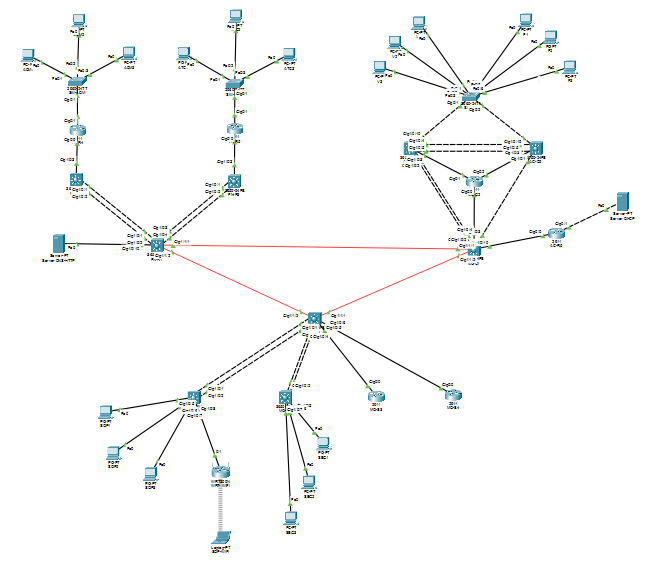

Los tres ISP se conectan en triángulo mediante enlaces de fibra entre sus routers/switches multicapa de borde (FN-R1, AC-C1 y MO-H), cada enlace con una subred /30 de la red `192.168.39.0`:

| Enlace | Red | Extremo A | Extremo B |
|---|---|---|---|
| FN-R1 ↔ AC-C1 | 192.168.39.0/30 | .1 | .2 |
| AC-C1 ↔ MO-H | 192.168.39.4/30 | .5 | .6 |
| MO-H ↔ FN-R1 | 192.168.39.8/30 | .9 | .10 |

### 2.2 FibraNet GT (árbol, OSPF)
Raíz FN-R1; ramas FN-R2 y FN-R3 (switches multicapa), hojas FN-R4 (Administración) y FN-R5 (Atención al Cliente). Dos enlaces LACP (Po1 y Po2) en FN-R1. Aloja el servidor DNS/HTTP/HTTPS.

### 2.3 AndinaCom (jerárquico, OSPF, HSRP)
Núcleo AC-C1 (+AC-C2), distribución AC-D1 y AC-D2 (par HSRP) y acceso con SW-A1. LACP: Po1 AC-C1↔AC-D1 (L3) y Po2 AC-D1↔AC-D2 (trunk). Aloja el servidor DHCP (AC-R5).

### 2.4 MoonLink (hub-and-spoke, EIGRP)
Hub MO-H; spokes MO-S1, MO-S2, MO-S3, MO-S4. LACP en MO-H (Po1, Po2) y MO-S1/S2 (Po1). Router inalámbrico WRT300N con SSID `MoonLink-WiFi` (WPA2-PSK, AES) y laptop conectada por WiFi.

### 2.5 Inventario de dispositivos
| Tipo | Modelo (Packet Tracer) | Cantidad | Dispositivos |
|---|---|---|---|
| Switch multicapa | 3650-24PS | 9 | FN-R1/R2/R3, AC-C1/D1/D2, MO-H/S1/S2 |
| Router | 2911 | 6 | FN-R4, FN-R5, AC-C2, AC-R5, MO-S3, MO-S4 |
| Switch de acceso | 2960-24TT | 3 | SW-ADM, SW-ACL, SW-A1 |
| Router inalámbrico | WRT300N | 1 | MoonLink-WiFi |
| Servidores | Server-PT | 2 | DNS/HTTP(S), DHCP |
| Dispositivos finales | PC / Laptop | 19 | ver tablas de direccionamiento |

## 3. Subneteo y justificación

- **FibraNet** — 172.16.19.0/24, hasta 75 hosts por departamento. 75 hosts requieren 7 bits de host (2⁷−2 = 126), por lo que se usa **/25** (máscara 255.255.255.128).
- **AndinaCom** — 172.16.29.0/24, tamaño libre. Se eligió **/26** (62 hosts útiles), suficiente y deja espacio sin usar.
- **MoonLink** — 172.16.32.0/24, hasta 45 hosts. 45 hosts requieren 6 bits (2⁶−2 = 62), por lo que se usa **/26**.
- **Enlaces e infraestructura** — 192.168.39.0 dividida en /30 (enlaces punto a punto) y bloques por ISP:
  FibraNet 192.168.39.32/27, AndinaCom 192.168.39.64/27, MoonLink 192.168.39.96/27; red de servidores 192.168.39.128/28 (DNS/HTTP /29 y DHCP /29).

### 3.1 Tabla de direccionamiento de departamentos
| ISP | Departamento | Red | Gateway | Detalle |
|---|---|---|---|---|
| FibraNet | Administración | 172.16.19.0/25 | 172.16.19.1 | Gateway en FN-R4 Gi0/1 |
| FibraNet | Atención al Cliente | 172.16.19.128/25 | 172.16.19.129 | Gateway en FN-R5 Gi0/1 |
| AndinaCom | Ventas (VLAN 10) | 172.16.29.0/26 | 172.16.29.1 (VIP HSRP) | AC-D1 .2 / AC-D2 .3 |
| AndinaCom | Facturación (VLAN 20) | 172.16.29.64/26 | 172.16.29.65 (VIP HSRP) | AC-D1 .66 / AC-D2 .67 |
| MoonLink | Soporte (VLAN 10) | 172.16.32.0/26 | 172.16.32.1 | MO-S1 (incluye WiFi) |
| MoonLink | Seguridad (VLAN 20) | 172.16.32.64/26 | 172.16.32.65 | MO-S2 |

### 3.2 Servidores (direccionamiento estático)
| Servidor | IP | Máscara | Gateway | Ubicación |
|---|---|---|---|---|
| DNS + HTTP/HTTPS | 192.168.39.130 | /29 | 192.168.39.129 | FN-R1 Gi1/0/10 |
| DHCP | 192.168.39.138 | /29 | 192.168.39.137 | AC-R5 Gi0/1 |

Los servidores son los únicos equipos con IP fija; todos los dispositivos finales usan DHCP.

## 4. Protocolos de enrutamiento

### 4.1 OSPF (FibraNet y AndinaCom) — área 0
Router-IDs 1.1.1.x (FibraNet) y 2.2.2.x (AndinaCom).
```
router ospf 1
 router-id 1.1.1.1
 network <red> <wildcard> area 0
 redistribute bgp 65001 subnets      ! solo en el router de borde
```
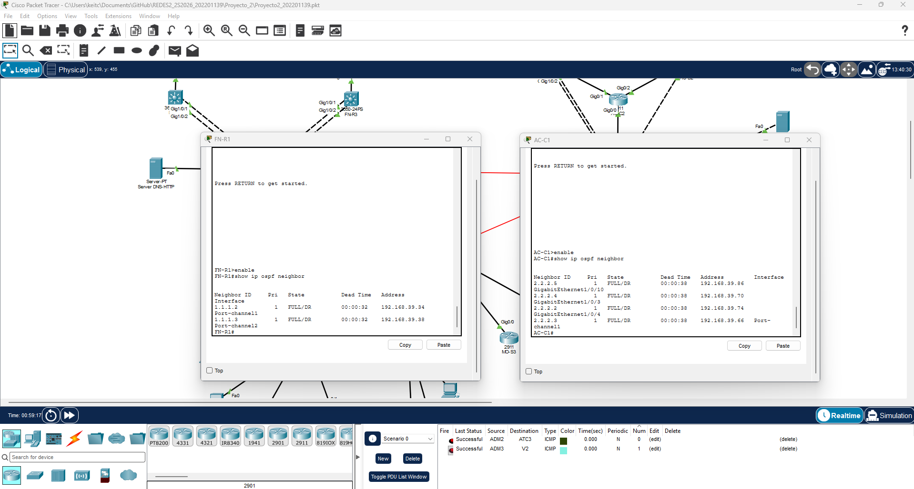

### 4.2 EIGRP AS 100 (MoonLink)
Router-IDs 3.3.3.x.
```
router eigrp 100
 network <red> <wildcard>
 redistribute bgp 65003 metric 1000000 10 255 1 1500   ! solo en MO-H
 no auto-summary
```
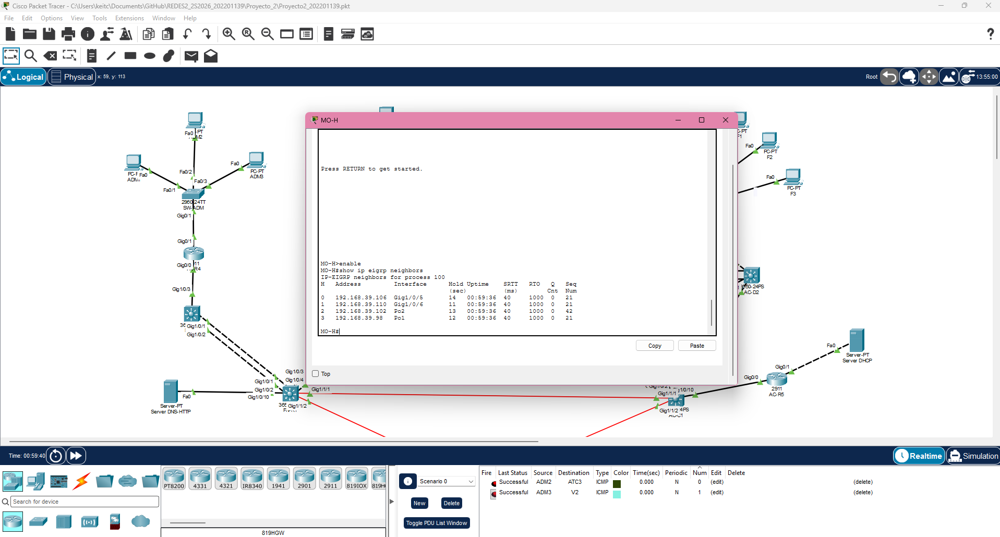

### 4.3 BGP entre ISP
Se anuncia cada /24 con una ruta de ancla a `Null0` (para que `network` la acepte) y se redistribuye BGP dentro del IGP.
```
! FN-R1 (AS 65001)
ip route 172.16.19.0 255.255.255.0 Null0
router bgp 65001
 neighbor 192.168.39.2 remote-as 65002
 neighbor 192.168.39.10 remote-as 65003
 network 172.16.19.0 mask 255.255.255.0
```
AC-C1 (AS 65002) y MO-H (AS 65003) siguen el mismo esquema con sus redes y vecinos.

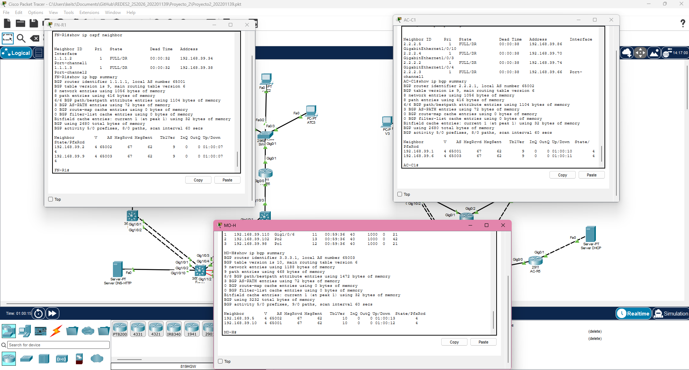
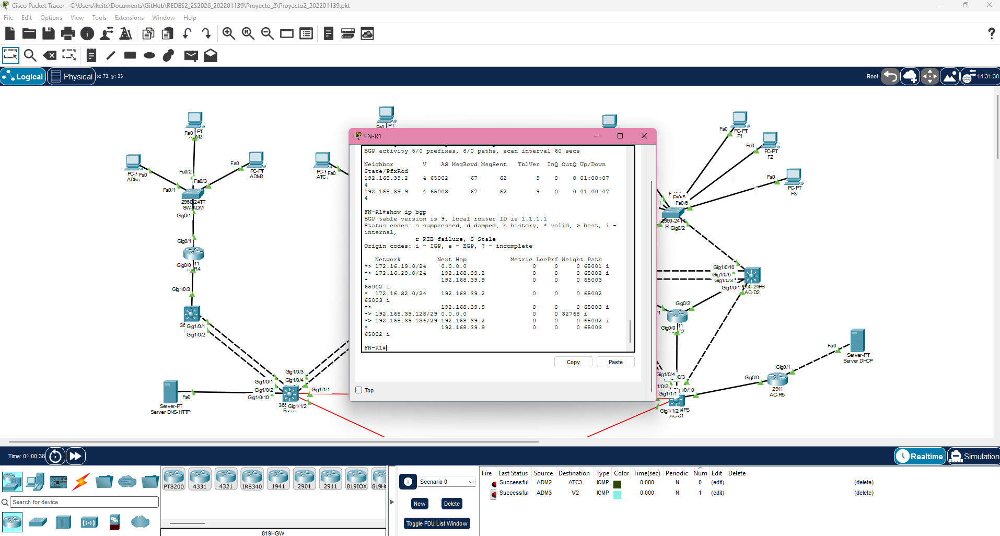

## 5. Agregación de enlaces (LACP)
Cada ISP tiene al menos dos EtherChannel en modo LACP (`channel-group N mode active`):

| ISP | Dispositivo | Port-channels |
|---|---|---|
| FibraNet | FN-R1 | Po1, Po2 |
| AndinaCom | AC-C1 / AC-D1 / AC-D2 | Po1 (L3 C1↔D1), Po2 (trunk D1↔D2) |
| MoonLink | MO-H / MO-S1 / MO-S2 | Po1, Po2 en el hub; Po1 en cada spoke |

```
interface port-channel 1
 no switchport            ! si es enlace L3
interface range gig1/0/1 - 2
 channel-group 1 mode active
```
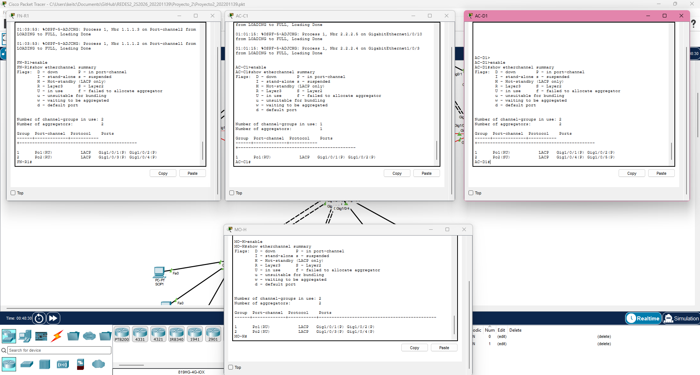

## 6. Redundancia de capa 3 — HSRP (AndinaCom)
AC-D1 es Active (prioridad 110, `preempt`) y AC-D2 Standby (prioridad por defecto 100) para los grupos 10 (Ventas) y 20 (Facturación). Spanning tree rapid-PVST con D1 como raíz (prioridad 4096) y D2 como secundaria (8192).
```
interface vlan 10
 ip address 172.16.29.2 255.255.255.192
 standby 10 ip 172.16.29.1
 standby 10 priority 110
 standby 10 preempt
```
Se verificó la conmutación apagando AC-D1: AC-D2 pasó a Active y el ping continuo perdió solo 4 de 95 paquetes mientras reconverge el enrutamiento (evidencia en la defensa/simulación).

## 7. Servicios

### 7.1 DHCP centralizado
Servidor 192.168.39.138 con pools ADM, ATC, VEN, FAC, SOP (serverPool) y SEG. Cada interfaz gateway usa `ip helper-address 192.168.39.138` para retransmitir las solicitudes.
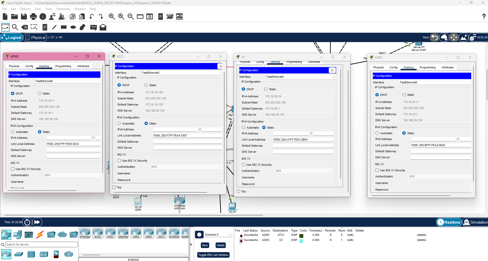

### 7.2 DNS y servidor web
Dominio `www.proyecto2_202201139.com` apuntando a 192.168.39.130; página estática con datos del estudiante y del curso, servida por HTTP y HTTPS.
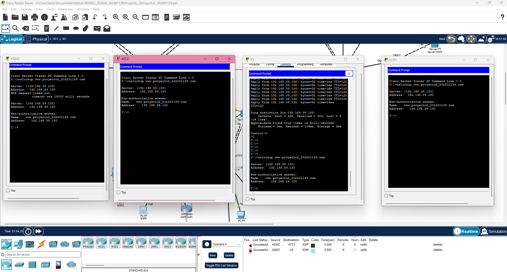
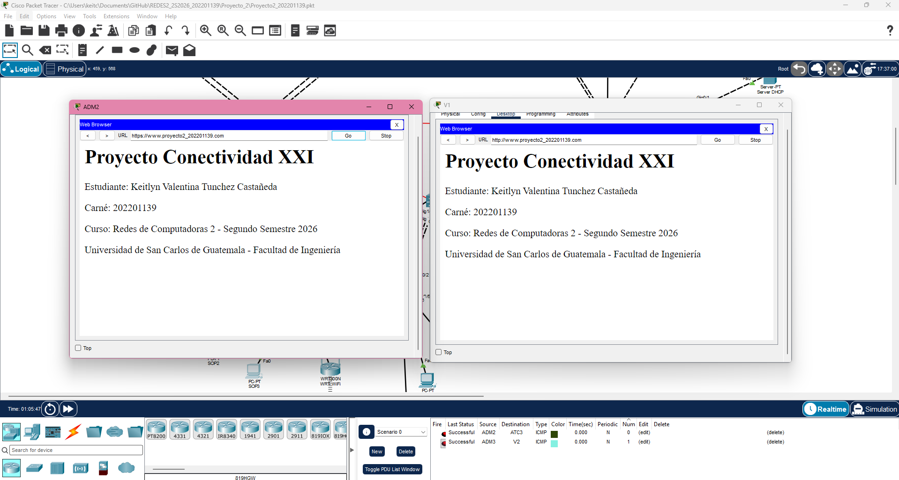

### 7.3 Red inalámbrica
Router WRT300N, SSID `MoonLink-WiFi`, seguridad WPA2-PSK con cifrado **AES** (TKIP está obsoleto), DHCP del router deshabilitado: el cliente WiFi (laptop con tarjeta WPC300N) recibe IP del servidor DHCP central.

## 8. Listas de control de acceso (ACL)

Se usan ACL **extendidas nombradas**, aplicadas **`in`** en la interfaz gateway de cada departamento, es decir, lo más cerca posible del origen. Así el tráfico no deseado se descarta antes de atravesar la red. Estructura común:

1. `permit udp any eq 68 any eq 67` (DHCP, para no romper la asignación de direcciones).
2. `permit` DNS (UDP/TCP 53), HTTP (80) y HTTPS (443) hacia el servidor 192.168.39.130, e ICMP hacia la red de servidores 192.168.39.128/28.
3. `permit icmp any any echo-reply` y `permit tcp any any established` (respuestas de conexiones iniciadas por otros).
4. Denegaciones hacia el/los departamentos no permitidos.
5. `permit ip any any` final.

En AndinaCom ambos switches llevan además `permit udp any host 224.0.0.2 eq 1985` al inicio, porque sin esa línea los *hello* de HSRP quedaban bloqueados y ambos switches se declaraban Active.

### 8.1 Dónde se aplicó cada ACL
| ACL | Dispositivo | Interfaz | Sentido | Justificación |
|---|---|---|---|---|
| ACL_ADM_IN | FN-R4 | Gi0/1 (gateway Administración) | in | Filtra el tráfico que *entra* desde Administración |
| ACL_ATC_IN | FN-R5 | Gi0/1 (gateway Atención) | in | Bloquea Atención → Facturación y Seguridad |
| ACL_VEN_IN | AC-D1 y AC-D2 | VLAN 10 | in | Filtra Ventas; aplicada en ambos por el HSRP |
| ACL_FAC_IN | AC-D1 y AC-D2 | VLAN 20 | in | Bloquea Facturación → Atención y Seguridad |
| ACL_SOP_IN | MO-S1 | VLAN 10 | in | Soporte hacia todos, bloquea hacia Seguridad |
| ACL_SEG_IN | MO-S2 | VLAN 20 | in | Seguridad inicia hacia todos |

### 8.2 Interpretación de la tabla de reglas
- Seguridad puede iniciar hacia cualquier departamento; **nadie** puede iniciar tráfico hacia Seguridad. Las respuestas a conexiones iniciadas por Seguridad regresan por `established` y `echo-reply`.
- Atención al Cliente ↔ Facturación: bloqueado en ambos sentidos.
- Administración y Soporte: acceso bidireccional a cualquier departamento (excepto iniciar hacia Seguridad).
- Ventas ↔ Facturación y Ventas ↔ Atención: permitidos (ICMP y TCP/80).

### 8.3 Matriz de pruebas
| Origen \ Destino | ADM | ATC | VEN | FAC | SOP | SEG |
|---|---|---|---|---|---|---|
| Administración | — | ✔ | ✔ | ✔ | ✔ | ✘ |
| Atención al Cliente | ✔ | — | ✔ | ✘ | ✔ | ✘ |
| Ventas | ✔ | ✔ | — | ✔ | ✔ | ✘ |
| Facturación | ✔ | ✘ | ✔ | — | ✔ | ✘ |
| Soporte | ✔ | ✔ | ✔ | ✔ | — | ✘ |
| Seguridad | ✔ | ✔ | ✔ | ✔ | ✔ | — |

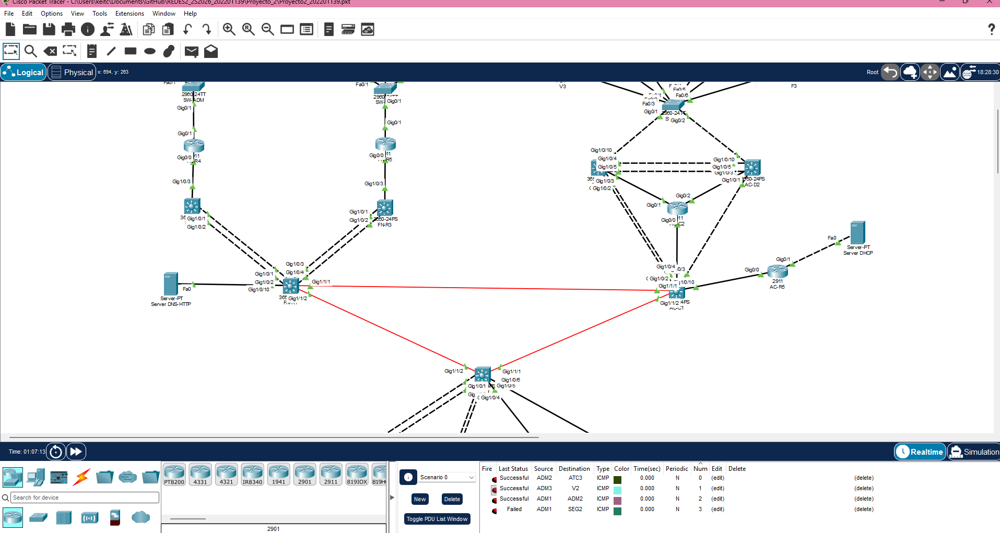
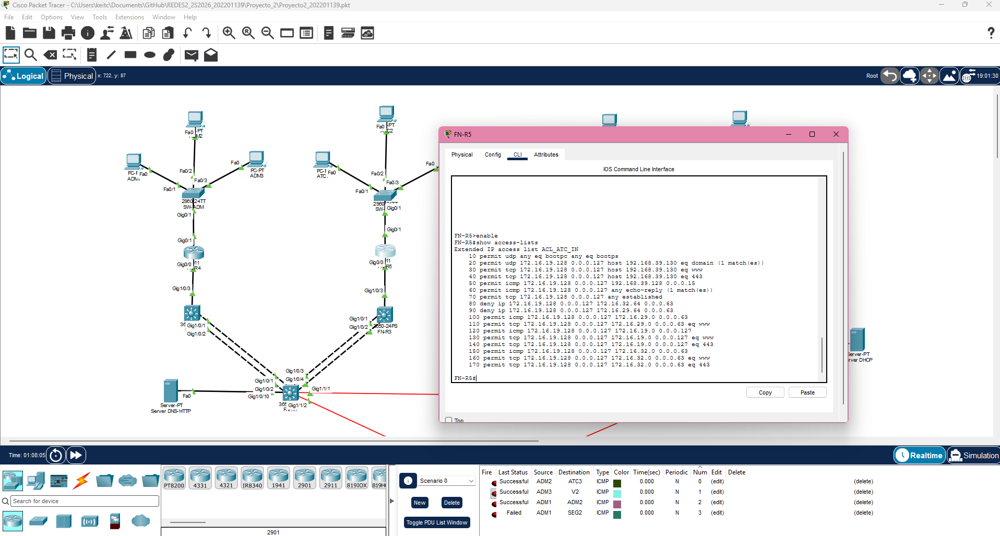

## 9. Análisis de tráfico con Wireshark

**Entorno:** máquina virtual Kali Linux en VirtualBox con red NAT (interfaz eth0, 10.0.2.15), de modo que solo se captura tráfico de la VM. Archivo: `Wireshark/captura_wireshark_202201139.pcapng` (116 paquetes). El tráfico se generó con `curl http://example.com`, `curl https://example.com`, `dig @8.8.8.8`, `nslookup … 1.1.1.1` y `ping 8.8.8.8`.

> Nota: los handshakes TCP, HTTP y TLS se realizaron sobre **IPv6** (`fd17:…` → `2606:4700:…`) porque la VM tiene conectividad IPv6; las consultas DNS a 8.8.8.8 y 1.1.1.1 y el ping van sobre IPv4. La explicación capa por capa es la misma.

### 9.1 Three-way handshake TCP (filtro `tcp.flags.syn == 1`)
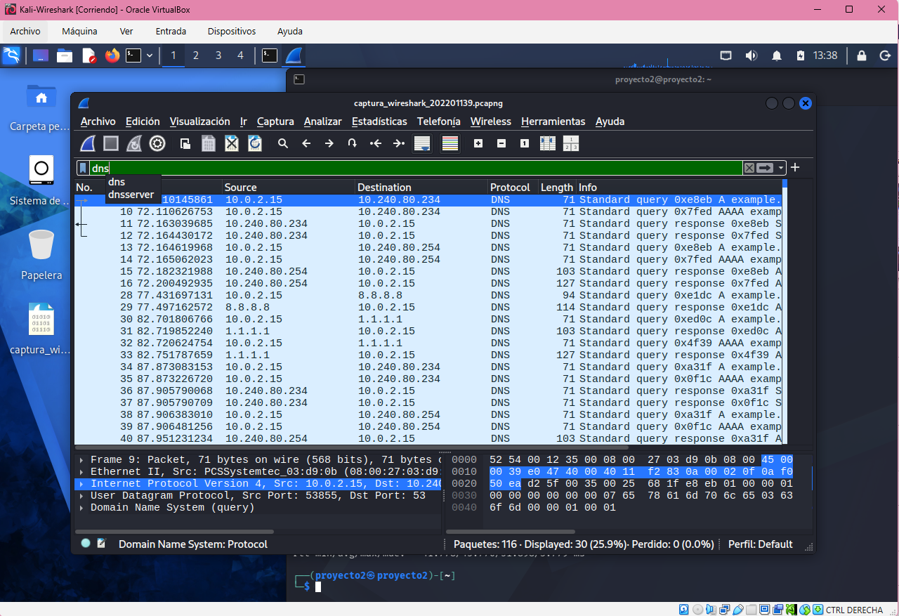

| Paso | Flags | Significado |
|---|---|---|
| 1 | SYN | El cliente propone un número de secuencia inicial (ISN) |
| 2 | SYN, ACK | El servidor envía su propio ISN y confirma ISN_cliente + 1 |
| 3 | ACK | El cliente confirma ISN_servidor + 1; la conexión queda establecida |

Capas: **Enlace** (Ethernet II, MAC origen/destino) → **Red** (IPv6/IPv4: direcciones, TTL/Hop Limit) → **Transporte** (TCP: puertos origen efímero y destino 80/443, secuencia, ACK, ventana, flags). Se observaron tres handshakes (puertos 80, 80 y 443).

### 9.2 Resolución DNS (filtro `dns`)
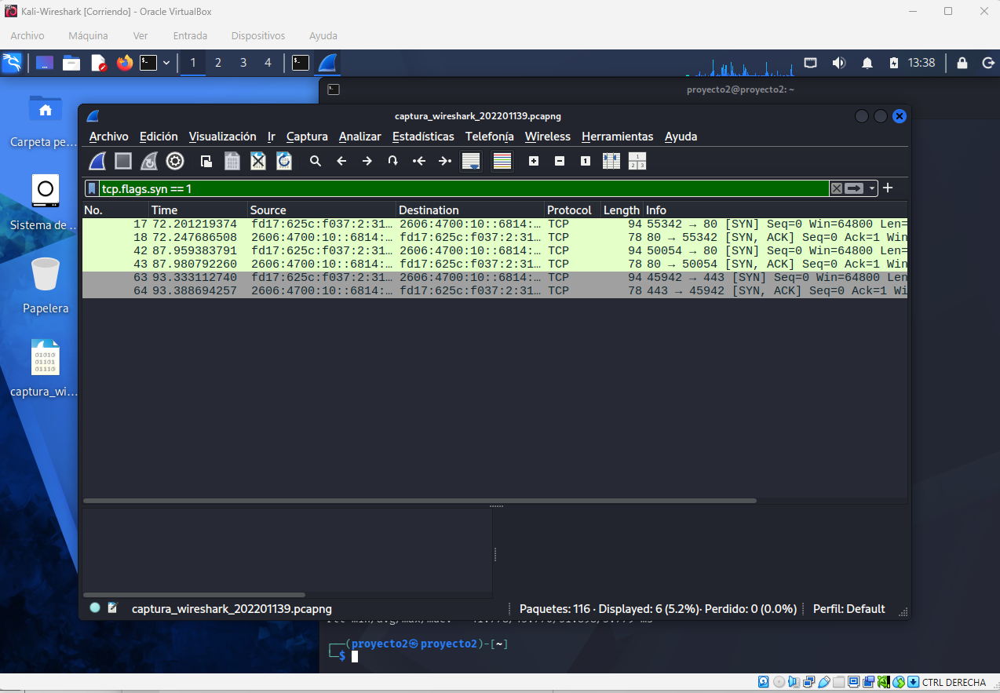

La consulta (tramas 28–29 a 8.8.8.8 y 30–33 a 1.1.1.1) viaja en **UDP con puerto destino 53** y puerto origen efímero. Consulta de tipo `A` (y `AAAA`), con *Recursion Desired*; la respuesta lleva el mismo *Transaction ID*, el registro con su **TTL** y la dirección IP resuelta. Capas: Ethernet → IPv4 → UDP → DNS.

### 9.3 HTTP vs HTTPS (filtros `http` y `tls.handshake`)
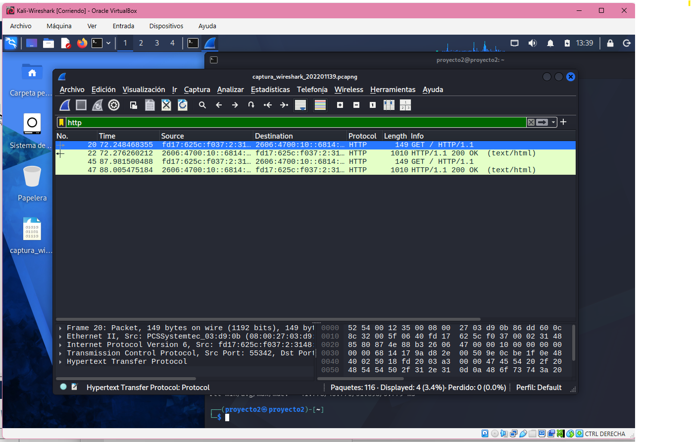
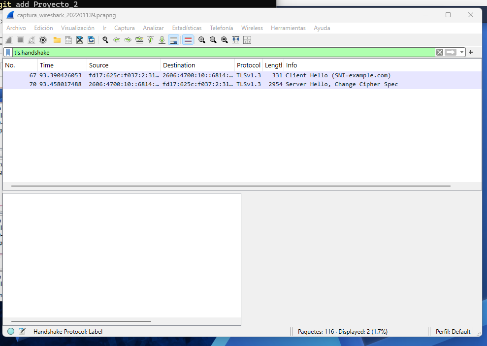

- **HTTP (80):** el `GET /` y la respuesta `200 OK` se ven en texto plano: método, cabeceras (`Host`, `User-Agent`) y el HTML del cuerpo.
- **HTTPS (443):** tras el handshake TCP aparece el **Client Hello** (trama 67; incluye la versión, los *cipher suites* y el SNI `example.com`) y el **Server Hello + Change Cipher Spec** (trama 70). En TLS 1.3 el resto del intercambio (certificado incluido) ya viaja cifrado, y los datos aparecen como *Application Data*.
- **Por qué el contenido aparece cifrado:** tras el intercambio de claves (ECDHE) cliente y servidor derivan claves simétricas de sesión; los datos HTTP se cifran con cifrado autenticado (AES-GCM/ChaCha20). Un tercero que capture los paquetes solo ve texto cifrado, sin acceso a la clave de sesión. Solo el SNI del Client Hello queda visible.

### 9.4 ICMP (filtro `icmp`)
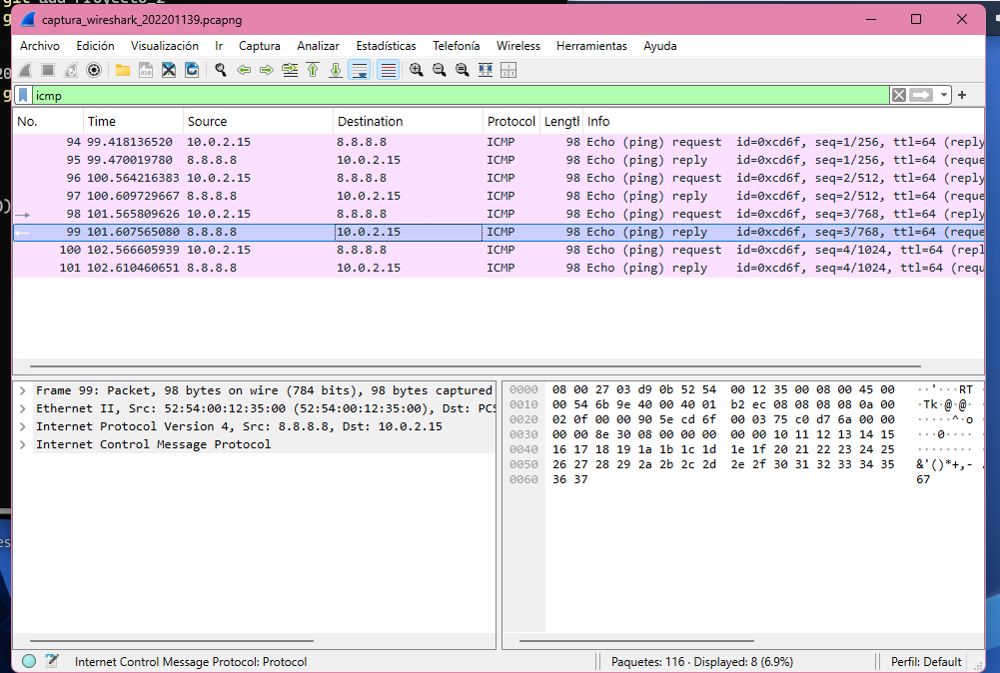

Tramas 94–101: Echo Request (tipo 8) y Echo Reply (tipo 0) con identificador `0xcd6f`, TTL 64 y números de secuencia consecutivos. Capas: Ethernet → IPv4 (protocolo 1) → ICMP.

## 10. Problemas encontrados y soluciones
| Problema | Causa | Solución |
|---|---|---|
| Sin puertos de fibra Gig1/1/x en los switches 3650 | Faltaban módulos | Instalar SFP `GLC-LH-SMD` (monomodo) con el equipo apagado |
| Port-channel Po2 AC-D1↔AC-D2 no se formaba | Dúplex/velocidad distintos entre puertos | `speed 1000` / `duplex full` en ambos extremos |
| DHCP "request failed" | Servicio DHCP del servidor apagado | Activar el servicio DHCP en Server-PT |
| HSRP en Active/Unknown tras aplicar ACL | La ACL bloqueaba los hello (UDP 1985 a 224.0.0.2) | `permit udp any host 224.0.0.2 eq 1985` en ACL_VEN_IN/ACL_FAC_IN |
| `interface range vlan 10,20` inválido | Limitación de Packet Tracer | Configurar `interface vlan 10` y `interface vlan 20` por separado |
| Los pools DHCP no entregaban la primera dirección del rango | El servidor reserva direcciones iniciales | Comportamiento esperado, sin impacto |

## 11. Archivos del repositorio
```
Proyecto_2/
├── Proyecto2_202201139.pkt          (todas las configuraciones por CLI)
├── Manual_Tecnico.md
├── Proyecto2_Presentacion_202201139.pdf
├── Wireshark/captura_wireshark_202201139.pcapng
└── img/                             (capturas de pantalla de las pruebas)
```
Las configuraciones completas (`show running-config`) de cada dispositivo están en el archivo `.pkt`.
